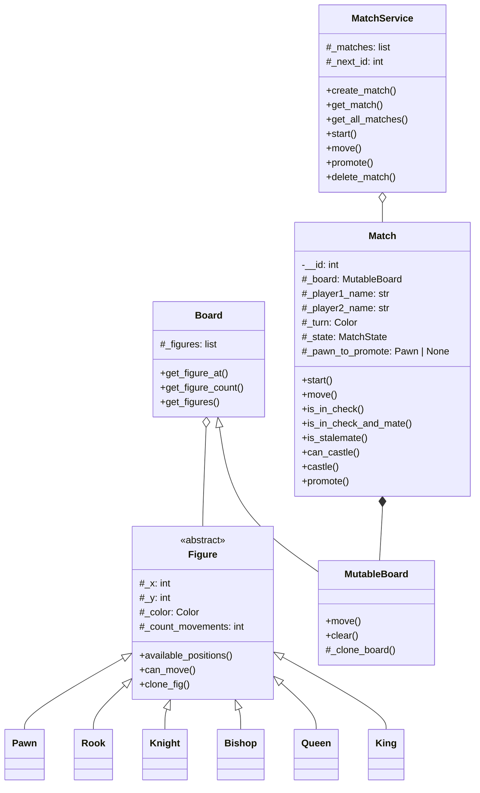

# ♟️ Chess Engine in Python

English | [Español](README.es.md)

A chess rules engine developed from scratch in Python, focused on object-oriented design, algorithm implementation, and behavior validation through automated tests.

The project does not use external chess engines such as `python-chess`. The pieces, movements, and implemented rules are part of an original solution.

## 🎯 About the project

This engine began as an academic project during my first year studying Web Application Development, when I had been learning to program for approximately six months.

The main goal was to translate the rules of chess into an object-oriented model, dividing responsibilities among pieces, the board, the match, and the match service.

The first version of the engine was developed over approximately three weeks while working on the project alongside my other classes. An important part of the process involved studying the board on paper, analyzing positions, and finding patterns that could later be converted into algorithms.

The project was later reviewed to strengthen edge cases, expand test coverage, and prepare a clean version for my portfolio.

## ✨ Implemented features

- Complete initial setup with 32 pieces.
- Specific movements for each type of piece.
- Turn control between White and Black.
- Capture of enemy pieces.
- Path blocking for rooks, bishops, and queens.
- L-shaped knight movement.
- Single-square movement and the initial two-square move for pawns.
- Diagonal pawn captures.
- Prevention of moves outside the board.
- Prevention of moves that leave the player's own king in check.
- Check detection.
- Checkmate detection.
- Stalemate detection.
- Kingside and queenside castling.
- Validation of the squares crossed during castling.
- Promotion to queen, rook, bishop, or knight.
- Board cloning to simulate moves without modifying the real match.
- A service for creating, retrieving, starting, playing, and deleting matches.

## 🧠 Algorithms and problem-solving

### Directional movement

The rook, bishop, and queen share a directional movement algorithm.

From a direction `(dx, dy)`, the engine progressively checks the squares until one of the following cases occurs:

1. The move goes outside the board.
2. A friendly piece is found.
3. An enemy piece that can be captured is found.
4. The path remains clear.

This makes it possible to reuse the same logic for horizontal, vertical, and diagonal movements.

### Move simulation

Before accepting a move, the engine clones the board and performs the move on the copy.

It then checks whether the player's king would be under threat. If the move leaves the player's own king in check, the move is rejected and the real board remains unchanged.

The same strategy is used to analyze possible responses to check and determine whether a position is checkmate or stalemate.

### Castling validation

To allow castling, the engine checks that:

- The king and rook are pieces of the correct types.
- Both belong to the same player.
- Neither piece has moved.
- There are no pieces between the king and the rook.
- The king is not currently in check.
- The king does not cross or finish on an attacked square.

### Promotion states

When a pawn reaches the final rank, the match enters the `WAITING_PROMOTION` state.

The turn does not change until the player selects a valid promotion among:

- Queen.
- Rook.
- Bishop.
- Knight.

## 🏗️ Architecture and object-oriented design



### Main responsibilities

- `Figure`: common abstract class for all pieces.
- `Pawn`, `Rook`, `Knight`, `Bishop`, `Queen`, and `King`: implement their specific movements.
- `Board`: provides read access to pieces and positions.
- `MutableBoard`: allows the board to be modified and cloned.
- `Match`: controls rules, turns, states, and movements.
- `MatchService`: manages multiple in-memory matches through identifiers.
- `Enums`: represents colors, states, castling sides, and promotion types.

### 🧩 Service layer

The project includes a `MatchService` responsible for managing the lifecycle of multiple matches: creation, retrieval, starting, movements, promotions, and deletion.

This service does not represent a web API and does not depend on any framework. It acts as an intermediate layer between the chess engine and any interface that may use it, such as a console application, a REST API, or a graphical interface.

Matches are currently stored only in memory. The project does not include persistence, authentication, or an HTTP server because its purpose is to demonstrate the engine implementation and the separation of responsibilities.

## 📂 Project structure

```text
python-chess-engine/
├── model/
│   ├── figures/
│   │   ├── __init__.py
│   │   ├── bishop.py
│   │   ├── figure.py
│   │   ├── king.py
│   │   ├── knight.py
│   │   ├── pawn.py
│   │   ├── queen.py
│   │   └── rook.py
│   ├── __init__.py
│   ├── board.py
│   ├── enums.py
│   ├── match.py
│   └── mutable_board.py
├── services/
│   ├── __init__.py
│   └── match_service.py
├── tests/
├── .gitignore
├── LICENSE
├── pyproject.toml
├── requirements-dev.txt
├── README.es.md
└── README.md
```

## 🧪 Tests

The project currently includes 61 automated tests.

Among other cases, the test suite covers:

- Initial piece placement.
- Movement of each type of piece.
- Blocked paths and captures.
- Turn alternation.
- Invalid moves.
- Attempts to move pieces that do not belong to the board.
- Self-check.
- Check and possible responses.
- Checkmate.
- Stalemate.
- Valid and invalid castling.
- Valid and invalid promotion.
- Movements and captures of White and Black pawns.
- `MatchService` operations.

## 🚀 Installation

### Requirements

- Python 3.13. Environment verified with Python 3.13.7.
- Git.

### Clone the repository

```bash
git clone https://github.com/brookk525/python-chess-engine.git
cd python-chess-engine
```

### Create the virtual environment

```bash
python3.13 -m venv .venv
```

On macOS or Linux:

```bash
source .venv/bin/activate
```

On Windows:

```powershell
.venv\Scripts\activate
```

### Install development dependencies

```bash
python -m pip install -r requirements-dev.txt
```

The engine does not require external dependencies at runtime. `pytest` is used only to run the tests.

## ✅ Run the tests

```bash
python -m pytest
```

Current result:

```text
61 passed
```

## ⚠️ Current limitations

This version focuses on the core rules and does not yet implement:

- En passant captures.
- Draw by threefold repetition.
- The fifty-move rule.
- Draw by insufficient material.
- Automatic match completion through `MatchState.FINISHED`.
- Algebraic notation.
- FEN/PGN import or export.
- Graphical interface.
- Play against artificial intelligence.
- Network multiplayer.

These limitations are part of the current scope and are planned as possible future improvements.

## 🗺️ Possible improvements

- Implement en passant captures.
- Complete the official draw rules.
- Add move history.
- Add algebraic notation.
- Create a more convenient public API for using the engine.
- Package the project as an installable library.
- Add continuous integration to run the tests automatically.

## 🤖 Supporting tools

The model design, rule implementation, and main algorithms were developed by the author.

During the project, artificial intelligence tools were used as support to generate an initial skeleton from a previous class design, expand test cases, and review edge cases.

These tools were used to support the learning process while preserving the author's understanding and ownership of the engine's architecture and behavior.

## 📚 What I learned

This project gave me practical experience with:

- Object-oriented design.
- Inheritance, abstraction, and polymorphism.
- Separation of responsibilities.
- Business rule modeling.
- Algorithms applied to a two-dimensional board.
- State simulation.
- Prevention of side effects.
- Automated testing.
- Debugging edge cases.
- Using Git with branches and small commits.

## 📜 License

This project is distributed under the MIT License. See the [LICENSE](LICENSE) file for more information.

## 👤 Author

**Brooklyn Muñoz Acevedo**

Web Application Development student.
