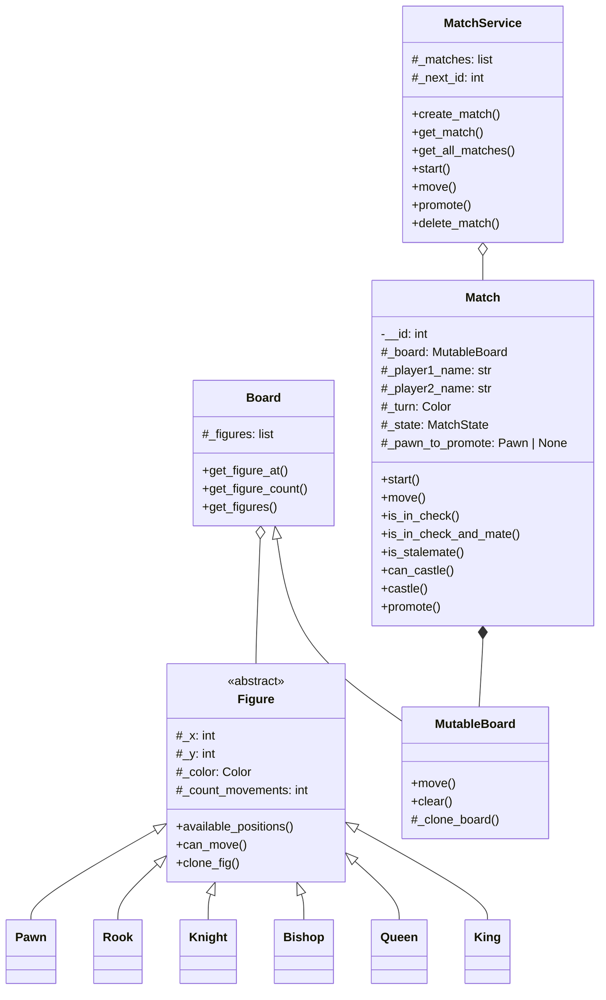

# ♟️ Motor de ajedrez en Python

Motor de reglas de ajedrez desarrollado desde cero en Python, centrado en el diseño orientado a objetos, la implementación de algoritmos y la validación del comportamiento mediante tests automatizados.

El proyecto no utiliza motores de ajedrez externos como `python-chess`. Las piezas, movimientos y reglas implementadas forman parte de una solución propia.

## 🎯 Sobre el proyecto

Este motor nació como un proyecto académico durante mi primer año de formación en Desarrollo de Aplicaciones Web, cuando llevaba aproximadamente seis meses aprendiendo a programar.

El objetivo principal era trasladar las reglas del ajedrez a un modelo orientado a objetos, dividiendo responsabilidades entre piezas, tablero, partida y servicio de partidas.

La primera versión del motor se desarrolló a lo largo de aproximadamente tres semanas, compaginando el proyecto con el resto de las clases. Una parte importante del proceso consistió en estudiar el tablero sobre papel, analizar posiciones y encontrar patrones que después pudieran convertirse en algoritmos.

Posteriormente, el proyecto fue revisado para reforzar casos límite, ampliar la cobertura de tests y preparar una versión limpia para portfolio.

## ✨ Características implementadas

- Configuración inicial completa con 32 piezas.
- Movimientos específicos para cada tipo de pieza.
- Control de turnos entre blancas y negras.
- Captura de piezas enemigas.
- Bloqueo de trayectorias para torre, alfil y reina.
- Movimiento en L del caballo.
- Avance simple y doble paso inicial de los peones.
- Captura diagonal de peones.
- Prevención de movimientos fuera del tablero.
- Prevención de movimientos que dejan al propio rey en jaque.
- Detección de jaque.
- Detección de jaque mate.
- Detección de ahogado.
- Enroque corto y largo.
- Validación de las casillas atravesadas durante el enroque.
- Promoción a reina, torre, alfil o caballo.
- Clonación del tablero para simular movimientos sin alterar la partida real.
- Servicio para crear, consultar, iniciar, mover y eliminar partidas.

## 🧠 Algoritmos y resolución de problemas

### Movimientos direccionales

La torre, el alfil y la reina comparten un algoritmo de desplazamiento direccional.

A partir de una dirección `(dx, dy)`, el motor recorre progresivamente las casillas hasta encontrar uno de estos casos:

1. El movimiento sale del tablero.
2. Aparece una pieza aliada.
3. Aparece una pieza enemiga que puede capturarse.
4. El camino permanece libre.

Esto permite reutilizar la misma lógica para movimientos horizontales, verticales y diagonales.

### Simulación de movimientos

Antes de aceptar un movimiento, el motor clona el tablero y realiza la jugada sobre la copia.

Después comprueba si el rey del jugador quedaría amenazado. Si el movimiento deja al propio rey en jaque, la jugada se rechaza y el tablero real permanece intacto.

Esta misma estrategia se utiliza para estudiar posibles respuestas ante un jaque y determinar si existe jaque mate o ahogado.

### Control del enroque

Para permitir un enroque se comprueba que:

- El rey y la torre sean piezas del tipo correcto.
- Ambos pertenezcan al mismo jugador.
- Ninguna de las dos piezas se haya movido.
- No existan piezas entre el rey y la torre.
- El rey no se encuentre actualmente en jaque.
- El rey no atraviese ni termine en una casilla amenazada.

### Estados de promoción

Cuando un peón alcanza la última fila, la partida entra en el estado `WAITING_PROMOTION`.

El turno no cambia hasta que el jugador selecciona una promoción válida entre:

- Reina.
- Torre.
- Alfil.
- Caballo.

## 🏗️ Arquitectura y orientación a objetos



### Responsabilidades principales

- `Figure`: clase abstracta común para todas las piezas.
- `Pawn`, `Rook`, `Knight`, `Bishop`, `Queen` y `King`: implementan sus movimientos específicos.
- `Board`: ofrece acceso de lectura a las piezas y posiciones.
- `MutableBoard`: permite modificar y clonar el tablero.
- `Match`: controla reglas, turnos, estados y movimientos.
- `MatchService`: administra múltiples partidas en memoria mediante identificadores.
- `Enums`: representa colores, estados, lados del enroque y tipos de promoción.

### 🧩 Capa de servicio

El proyecto incluye un `MatchService` encargado de gestionar el ciclo de vida de varias partidas: creación, consulta, inicio, movimientos, promociones y eliminación.

Este servicio no representa una API web ni depende de ningún framework. Actúa como una capa intermedia entre el motor de ajedrez y cualquier posible interfaz que quiera utilizarlo, como una aplicación de consola, una API REST o una interfaz gráfica.

Actualmente, las partidas se almacenan únicamente en memoria. El proyecto no incluye persistencia, autenticación ni servidor HTTP, ya que su objetivo es mostrar la implementación del motor y la separación de responsabilidades.

## 📂 Estructura del proyecto

```text
python-chess-engine/
├── model/
│   ├── figures/
│   │   ├── __init__.py
│   │   ├── bishop.py
│   │   ├── figure.py
│   │   ├── king.py
│   │   ├── knight.py
│   │   ├── pawn.py
│   │   ├── queen.py
│   │   └── rook.py
│   ├── __init__.py
│   ├── board.py
│   ├── enums.py
│   ├── match.py
│   └── mutable_board.py
├── services/
│   ├── __init__.py
│   └── match_service.py
├── tests/
├── .gitignore
├── LICENSE
├── pyproject.toml
├── requirements-dev.txt
└── README.md
```

## 🧪 Tests

El proyecto cuenta actualmente con 61 tests automatizados.

La suite cubre, entre otros casos:

- Colocación inicial de las piezas.
- Movimiento de cada tipo de pieza.
- Bloqueos y capturas.
- Alternancia de turnos.
- Movimientos inválidos.
- Intentos de mover piezas ajenas al tablero.
- Autojaque.
- Jaque y respuestas posibles.
- Jaque mate.
- Ahogado.
- Enroque válido e inválido.
- Promoción válida e inválida.
- Movimientos y capturas de peones blancos y negros.
- Operaciones de `MatchService`.

## 🚀 Instalación

### Requisitos

- Python 3.13. Entorno verificado con Python 3.13.7.
- Git.

### Clonar el repositorio

```bash
git clone https://github.com/brookk525/python-chess-engine.git
cd python-chess-engine
```

### Crear el entorno virtual

```bash
python3.13 -m venv .venv
```

En macOS o Linux:

```bash
source .venv/bin/activate
```

En Windows:

```powershell
.venv\Scripts\activate
```

### Instalar dependencias de desarrollo

```bash
python -m pip install -r requirements-dev.txt
```

El motor no necesita dependencias externas durante su ejecución. `pytest` se utiliza únicamente para ejecutar los tests.

## ✅ Ejecutar los tests

```bash
python -m pytest
```

Resultado actual:

```text
61 passed
```

## ⚠️ Limitaciones actuales

Esta versión está centrada en el núcleo de reglas y todavía no implementa:

- Captura al paso.
- Tablas por triple repetición.
- Regla de los 50 movimientos.
- Tablas por material insuficiente.
- Finalización automática de la partida mediante `MatchState.FINISHED`.
- Notación algebraica.
- Importación o exportación FEN/PGN.
- Interfaz gráfica.
- Juego contra inteligencia artificial.
- Multijugador por red.

Estas limitaciones forman parte del alcance actual y están previstas como posibles mejoras futuras.

## 🗺️ Posibles mejoras

- Implementar captura al paso.
- Completar las reglas oficiales de tablas.
- Añadir historial de movimientos.
- Incorporar notación algebraica.
- Crear una API pública más cómoda para consumir el motor.
- Empaquetar el proyecto como librería instalable.
- Añadir integración continua para ejecutar los tests automáticamente.

## 🤖 Herramientas de apoyo

El diseño del modelo, la implementación de las reglas y los algoritmos principales fueron desarrollados por el autor.

Durante el proyecto se utilizaron herramientas de inteligencia artificial como apoyo para generar un esqueleto inicial a partir de un diseño de clases previo, ampliar casos de prueba y revisar casos límite.

El uso de estas herramientas se realizó como apoyo al proceso de aprendizaje, manteniendo la comprensión y autoría sobre la arquitectura y el funcionamiento del motor.

## 📚 Aprendizajes

Este proyecto me permitió trabajar especialmente:

- Diseño orientado a objetos.
- Herencia, abstracción y polimorfismo.
- Separación de responsabilidades.
- Modelado de reglas de negocio.
- Algoritmos aplicados a un tablero bidimensional.
- Simulación de estados.
- Prevención de efectos secundarios.
- Testing automatizado.
- Depuración de casos límite.
- Uso de Git mediante ramas y commits pequeños.

## 📜 Licencia

Este proyecto se distribuye bajo la licencia MIT. Consulta el archivo [LICENSE](LICENSE) para obtener más información.

## 👤 Autor

**Brooklyn Muñoz Acevedo**

Estudiante de Desarrollo de Aplicaciones Web.
